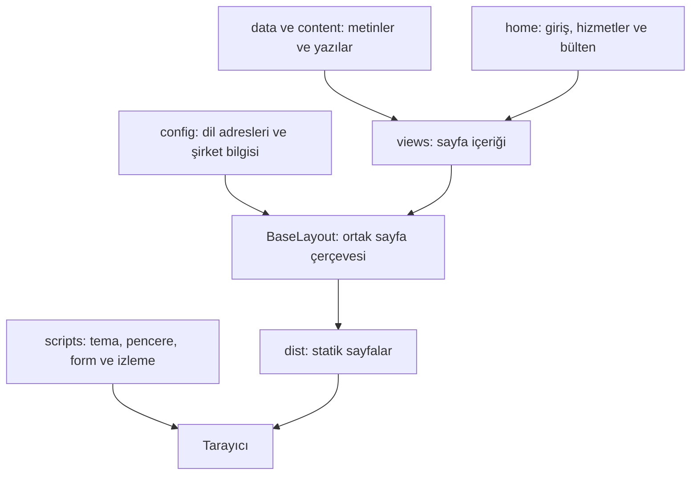
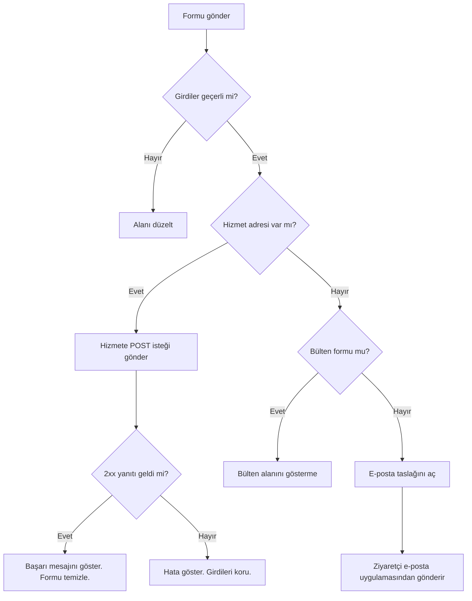

# Kuadron web sitesi

Site, Astro ve TypeScript ile statik sayfalar üretir.
Türkçe ve İngilizce kurumsal sayfalar vardır.
Blog yazıları Markdown dosyalarında tutulur.

## Çalıştırma

Node.js 20 veya daha yeni bir sürüm kullanın.

```sh
npm ci
npm run dev
```

Yerel adres: `http://localhost:4321`.

## Kontrol ve derleme

Önce siteyi derleyin. Sonra testleri çalıştırın.
Çıktı testleri `dist/` dizinini okur.

```sh
npm run build
npm test
npm run preview
```

Son yerel kontrolde 93 sayfa üretildi.
23 test geçti.
Bu sayılar, 31 Ekim 2026 tarihindeki sürüm içindir.

## İçerik sınırı

Kuadron’un mevcut kurumsal metinlerini koruyun.
Arayüz değişikliği sırasında başlıkları ve açıklamaları yeniden yazmayın.
Yeni ürün içerikleri eklenebilir.
OzBI ve Strife, Kuadron’un ürün portföyünde yer alır.
Ana sayfanın ana mesajı Kuadron’a aittir.
`tests/fixtures/corporate-copy.json`, ilk kurumsal metinleri ve mevcut ürün açıklamalarını koruyan test kaydıdır.
Bu kaydı yalnızca açık bir içerik değişikliği isteği varsa güncelleyin.

## Dosya yapısı



| İş | Dosya veya dizin |
| --- | --- |
| Dil adreslerini değiştirin | `src/config/routes.ts` |
| Şirket bilgisini değiştirin | `src/config/company.ts` |
| Ortak veri tiplerini değiştirin | `src/data/types.ts` |
| Kurumsal metni değiştirin | `src/data/site-content.ts` |
| Basın kaydı ekleyin | `src/data/press-archive.ts` |
| Blog yazısı ekleyin | `src/content/blog/` |
| Ana sayfayı değiştirin | `src/components/home/` ve `src/components/views/HomeView.astro` |
| Ortak renkleri değiştirin | `src/styles/global.css` |
| Form davranışını değiştirin | `src/scripts/forms.ts` |
| İzleme seçimini değiştirin | `src/scripts/consent.ts` |

## Form bağlantıları

`.env.example` dosyasını `.env` adıyla kopyalayın.
Gerekli hizmet adreslerini girin.
Bu değerler, derleme sırasında sayfalara eklenir.
Değerleri değiştirince siteyi tekrar derleyin.

| Değer | Kullanım |
| --- | --- |
| `PUBLIC_CONTACT_ENDPOINT` | İletişim formu |
| `PUBLIC_NEWSLETTER_ENDPOINT` | Bülten formu |
| `PUBLIC_FRANCHISE_ENDPOINT` | Bayilik başvurusu |
| `PUBLIC_CAREER_ENDPOINT` | İş başvurusu |
| `PUBLIC_GA_ID` | İsteğe bağlı Google Analytics kimliği |

Hizmet adresi, `multipart/form-data` ile `POST` isteği almalıdır.
Başarılı kayıt için `2xx` yanıtı vermelidir.
Başka bir alan adı kullanırsa, siteye CORS izni vermelidir.
İstek 15 saniyede tamamlanmazsa hata gösterilir.
Sunucu, girdileri ve istek sınırını kendi tarafında kontrol etmelidir.
`PUBLIC_` değerlerine gizli anahtar koymayın.



Hizmet yoksa iletişim ve başvuru formları e-posta taslağı açar.
Bu işlem, mesajın gönderildiği anlamına gelmez.
Bülten hizmeti yoksa bülten alanı gösterilmez.
Mevcut Jotform bağlantıları da kullanılabilir.

## İzleme ve tema

Google Analytics, geçerli bir `G-...` kimliği varsa kullanılabilir.
Kod, ziyaretçi izin verince yüklenir.
Ziyaretçi, sayfa altındaki düğme ile seçimini değiştirebilir.
Tema ve izleme seçimi tarayıcıda saklanır.
Tarayıcı bu kaydı engellerse sayfa çalışmaya devam eder.

## Yayınlama

`npm run build` ile `dist/` dizinini oluşturun.
Statik sunucunun kök dizini olarak `dist/` seçin.
Sunucu, klasör adresleri için `index.html` sunmalıdır.
Bulunamayan adreslerde `404.html` ve HTTP 404 yanıtı kullanılmalıdır.

[OzBI ve Strife ürün güncellemesini okuyun](docs/product-update.md).

[Ek denetim düzeltmelerini okuyun](docs/audit-followup.md).

[İlk inceleme notlarını okuyun](docs/review.md).
