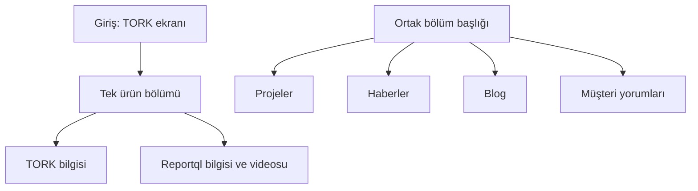
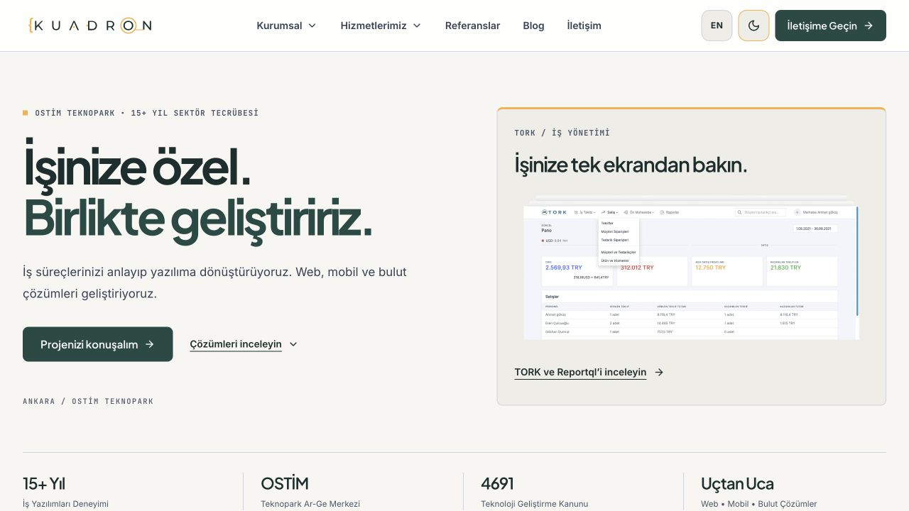
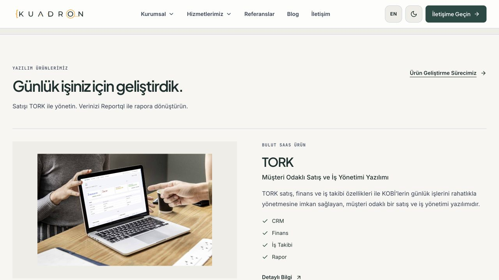

# Ek denetim düzeltmeleri

Tarih: 31 Ekim 2026.
Kaynak: Bağımsız denetim raporu.
Kapsam: Teknik bulgular ve ana sayfanın görsel bütünlüğü.

## Teknik sonuçlar

| Bulgu | Yapılan düzeltme | Kontrol |
| --- | --- | --- |
| Telefon kuralı `v` kipinde geçersizdi. | Karakter kaçışları düzeltildi. | Derlenmiş HTML kuralı test edildi. Tarayıcı, harfleri reddetti. |
| SEO adresleri farklı `/` kuralları kullanıyordu. | Ortak adres kuralı eklendi. Dil tablosu güncellendi. | Site haritasındaki her adres, sayfanın canonical adresiyle karşılaştırıldı. Dil bağlantıları da kontrol edildi. |
| Çerez düğmesi açık temada okunmuyordu. | Açık metin rengi verildi. Düğme, alt bağlantı grubuna taşındı. | Tarayıcıdaki renklerle yaklaşık 12,41:1 kontrast hesaplandı. |
| Escape, odak menü dışındayken çalışmıyordu. | Klavye kontrolü belge düzeyine alındı. | Odak diğer menüdeyken açık menü kapandı. Odak yerinde kaldı. |
| Mobil menü etkin sayfayı belirtmiyordu. | Etkin bağlantılara `aria-current` eklendi. | Mobil Kariyer bağlantısı kontrol edildi. |
| Zorunlu başvuru alanında hata açıklaması yoktu. | Alanın altına hata metni eklendi. | Boş alandan çıkınca metin göründü. Metin, alanla ilişkilendirildi. |
| Form sıfırlanınca eski hata durumu kalıyordu. | Görsel ve erişilebilir hata durumu birlikte temizlenir. | Otomatik test geçti. |
| Başvuruya özel yedek mesaj kullanılmıyordu. | Formun özel mesajı ve düğme metni tekrar kullanılır. | Otomatik test geçti. Gönderilmemiş mesaj, gönderilmiş gibi gösterilmez. |

Hata, alanla etkileşimden sonra gösterilir.
Hatalı alana `aria-describedby` eklenir.
Geçerli girişte hata bağlantısı kaldırılır.
Mevcut yardım metinleri korunur.
Form hataları, canlı bildirim alanında açıklanır.

## Görsel sonuçlar

Ürünlerin ayrıntılı tanıtımı tek bölüme toplandı.
Girişte yalnızca TORK ekranı ve ürün bölümüne bağlantı var.
Yanıltıcı `01 / 02` göstergesi kaldırıldı.
Giriş görselinin gerçek yüksekliği kullanıldı.
Reportql videosu, Reportql başlığı altına taşındı.

Proje, haber, blog ve yorum bölümleri aynı başlık ve çizgi düzenini kullanır.
İletişim bölümündeki kartlar da sadeleştirildi.
Kullanılmayan süreç ikon verileri kaldırıldı.
Ana sayfa dosyası, bölüm bileşenlerini birleştirir.

## Doğrulama

- 93 sayfa derlendi.
- Tip kontrolünde hata ve uyarı yok.
- 20 otomatik test geçti.
- 320 ve 390 piksel genişlikte yatay taşma yok.
- Açık ve koyu tema tarayıcıda kontrol edildi.
- Telefon ve başvuru hataları tarayıcıda kontrol edildi.
- Son tarayıcı kontrolünde konsol hatası görülmedi.
- Görseller, derlenmiş sitenin önizlemesinden alındı. Geliştirici araç çubuğu yok.

Gerçek form hizmeti bağlı değil. Teslim ve abone kaydı doğrulanmadı.
Canlı siteye yayın yapılmadı.
Git deposu oluşturulmadı.

## Görseller

[Ana sayfa, koyu tema](screenshots/home-dark.jpg) · [Mobil görünüm](screenshots/home-mobile.jpg)
