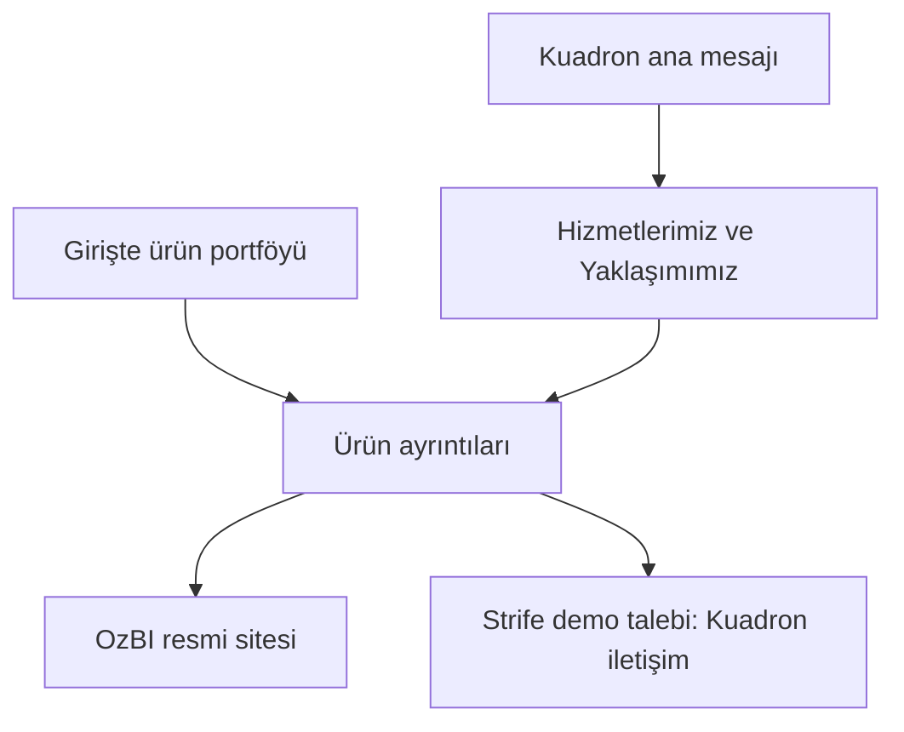
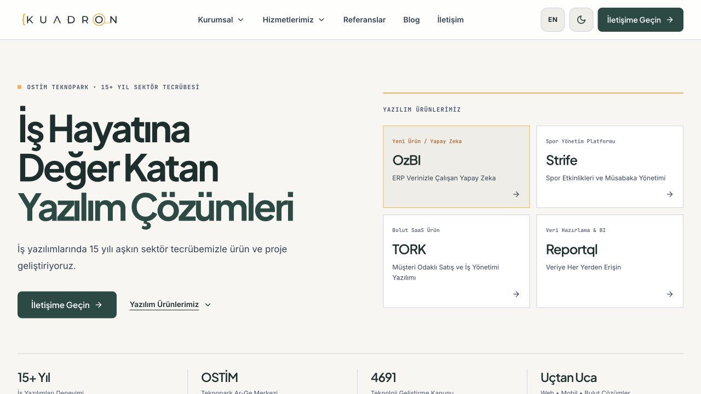
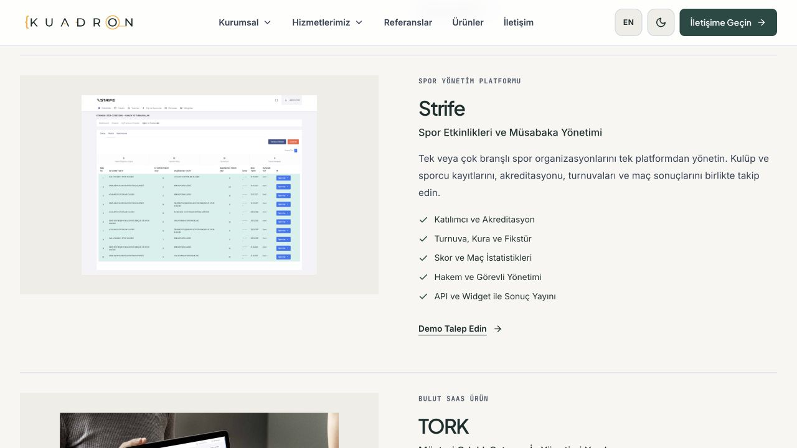

# OzBI ve Strife ürün güncellemesi

Tarih: 31 Ekim 2026.

## Yerleşim

| Alan | Değişiklik |
| --- | --- |
| Türkçe ve İngilizce ana sayfa | Kuadron’un özgün ana başlığı, açıklaması ve SEO metinleri korundu. |
| Ana sayfa ürün bölümü | Hizmetlerimiz ve Yaklaşımımız bölümlerinin ardından gelir. Girişin yanında dört ürün için kısa bir portföy paneli vardır. |
| Ürün sırası | OzBI, Strife, TORK, Reportql. OzBI, yeni ürün olarak işaretlenir. |
| Türkçe ve İngilizce ürün sayfası | Aynı ürün verileri ve aynı gösterim bileşeni kullanılır. KYS de listede kalır. |
| Strife | Eski Front Runner adı ve görseli kaldırıldı. Sunumdaki gerçek turnuva ekranı kullanıldı. |
| Menü ve alt bilgi | Mevcut menü bağlantıları korundu. Ürün paneli ve alt bilgi üzerinden yeni ürünlere erişilir. |

## İçerik sınırı

Mevcut kurumsal metinler ilk kaynak dosyalarından geri yüklendi.
Ana başlık, giriş açıklaması, hizmetler, yaklaşım ve blog başlıkları yeniden yazılmaz.
Yeni metinler, OzBI ve Strife ürün eklemeleriyle sınırlıdır.

## İçerik kaynakları

OzBI metni, [resmi ürün sitesindeki](https://www.ozbiapp.com.tr/) özelliklere göre yazıldı.
Yerel ve hibrit kurulum seçenekleri ayrı tutuldu.
OzBI ürün ayrıntısında gerçek sonuç gibi gösterilen örnek sayısal veriler kullanılmadı.
Ürünün işleyişi kendi ürün alanında bir şema ile anlatılır.

Strife metni, kullanıcı tarafından sağlanan **Strife TR Sunum 2026.pdf** belgesine dayanır.
Etkinlik, akreditasyon, turnuva, fikstür ve maç yönetimi özellikleri 2–5. sayfalardan alındı.
Sonuç yayını bilgisi 5. sayfadan alındı.
Turnuva ekranı, 7. sayfadaki gömülü görselden çıkarıldı. Görsel değiştirilmedi.
Kaynak PDF bu siteye kopyalanmadı.

Kullanıcı, Strife’ın web sitesi olmadığını belirtti.
Bu nedenle Strife için dış site bağlantısı yoktur.
Demo düğmesi, ilgili dildeki Kuadron iletişim bölümüne gider.

## Bakım

Ürün metinleri `src/data/site-content.ts` dosyasındadır.
`featuredOnHome`, ürünün ana sayfada gösterilmesini belirler.
Ana sayfada ilk iki ürünü alan sabit bir kesme işlemi kullanılmaz.
`ProductShowcase.astro`, ana sayfa ile ürün sayfalarının ortak bileşenidir.

## Kontrol

- 93 sayfa derlendi.
- Tip kontrolünde hata ve uyarı yok.
- 23 test geçti.
- Her iki dildeki ürün sırası ve Kuadron ana mesajı test edildi.
- İlk kurumsal metinlerin ve mevcut ürün açıklamalarının değişmediği test edildi.
- Strife’ın görseli ve iç iletişim bağlantısı test edildi.
- 320 ve 390 piksel genişlikte yatay taşma yok.
- Canlıya yayın yapılmadı.

## Görseller

[Mobil ana sayfa](screenshots/kuadron-home-mobile.jpg)
