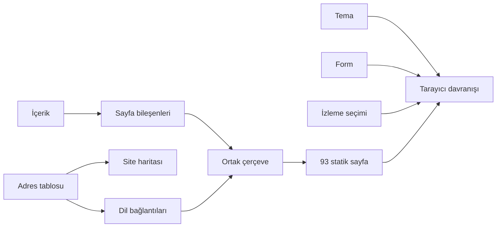

# İnceleme notu

Tarih: 31 Ekim 2026.
Kapsam: Yerel proje dosyaları ve yerel önizleme.

Bu belge ilk incelemeyi kaydeder. [Son düzeltmeler ve 20 testin sonucu için ek notu okuyun](audit-followup.md).

## Bulgular ve düzeltmeler

| Bulgu | Sonuç |
| --- | --- |
| Bülten formu, kayıt yapmadan başarı mesajı veriyordu. | Hizmet yoksa alan gizlenir. Form kodu da yanlış başarı mesajını engeller. |
| İzleme kodu, izin beklemeden yükleniyordu. | Kod yalnızca açık izin sonrası yüklenir. Ret ve seçim değiştirme düğmeleri eklendi. |
| `/en/` adresinde dil eşleşmesi bozuluyordu. | Adresler tek bir kuralla işlenir. Dil bağlantıları doğru sayfayı gösterir. |
| Site haritası, çevrilmiş adresleri eşleyemiyordu. | Site haritası ve sayfalar aynı adres tablosunu kullanır. |
| Mobil menüde düğme stili, gizleme kuralını geçersiz kılıyordu. | Düğme stilleri CSS bileşen katmanına alındı. |
| Masaüstü alt menüsü, fare ve odak durumuna bağlıydı. | Yerel açılır menü kullanıldı. Tıklama ve Escape tuşu desteklenir. |
| Form hataları, başarı rengiyle görünüyordu. | Hata, bilgi ve başarı durumları ayrıldı. |
| Aynı form için birden çok istek gönderilebiliyordu. | Devam eden istek sırasında yeni gönderim engellenir. |
| Müşteri kayıtlarında puan verisi yoktu. Ekranda 5/5 puanı vardı. | Kaynağı olmayan puanlar kaldırıldı. Yorum metinleri korundu. |

## Mimari

Astro altyapısı korundu.
Adresler, şirket bilgisi ve veri tipleri ayrı dosyalara alındı.
Ortak sayfa dosyası küçültüldü.
Tarayıcı kodu, görevine göre ayrıldı.
Ana sayfanın giriş, hizmet ve bülten alanları ayrı bileşenler oldu.

## Görünüm

Ana sayfa, iki sütunlu bir giriş alanı kullanır.
Birincil düğme, proje görüşmesine gider.
Ürün ekranı ilk bölümde görünür.
Hizmetler, üç bağlantılı satırla gösterilir.
Çalışma süreci, sıralı adımlar ve oklarla gösterilir.
Mobilde adımlar alt alta görünür.
Video kendiliğinden başlamaz.

## Kontroller

- Tip kontrolü ve statik derleme çalıştırıldı.
- 93 HTML sayfası üretildi.
- 14 otomatik test geçti.
- Üretilen sayfalardaki yerel bağlantılar ve medya yolları kontrol edildi.
- Tek başlık, tek ana başlık ve JSON-LD yapısı kontrol edildi.
- Dil geçişi ve site haritasındaki adres eşleşmesi kontrol edildi.
- Form yanıtları, başarı ve hata örnekleriyle taklit edildi.
- Yerel tarayıcıda açık ve koyu tema kontrol edildi.
- Masaüstü menüsünde açma ve Escape ile kapatma denendi.
- Mobil menüde açma ve kapatma denendi.
- 320, 390, 1024 ve 1280 piksel genişlikte yatay taşma kontrol edildi.

Gerçek form hizmeti tanımlı değildi.
E-posta teslimi ve gerçek abone kaydı bu nedenle doğrulanmadı.
Dış basın bağlantılarının içeriği bu incelemede kontrol edilmedi.
Mevcut genel çerez metni korundu. Güncel teknik davranış için ayrı bir bilgi alanı eklendi.

## Dosya durumu

Bu klasörde Git geçmişi yoktu.
İlk kaynak dosyalar `/tmp/kuadron-before-review/` dizinine kopyalandı.
Bu kopya geçicidir.
Canlı siteye yayın yapılmadı.
